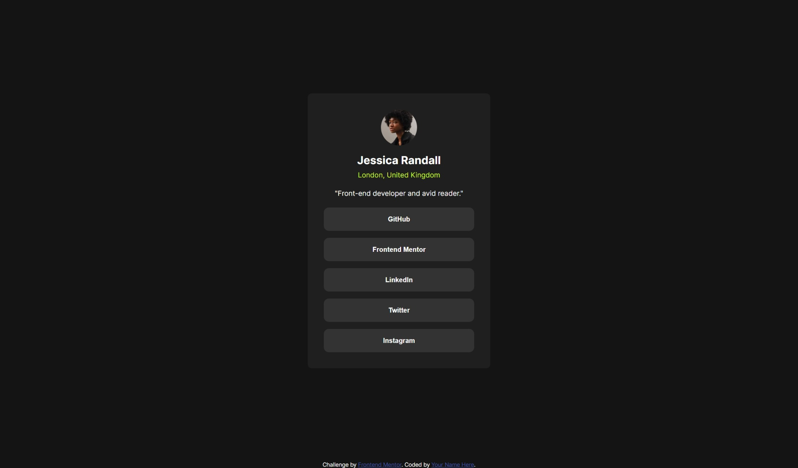

# Frontend Mentor - Social links profile solution

This is a solution to the [Social links profile challenge on Frontend Mentor](https://www.frontendmentor.io/challenges/social-links-profile-UG32l9m6dQ). Frontend Mentor challenges help you improve your coding skills by building realistic projects. 

## Table of contents

- [Overview](#overview)
  - [The challenge](#the-challenge)
  - [Screenshot](#screenshot)
  - [Links](#links)
- [My process](#my-process)
  - [Built with](#built-with)
  - [What I learned](#what-i-learned)
  - [Continued development](#continued-development)
  - [Useful resources](#useful-resources)


## Overview

### The challenge

Users should be able to:

- See hover and focus states for all interactive elements on the page

### Screenshot



### Links

- Solution URL: [Solution URL](https://github.com/mh2000hm/social-links-profile-main)
- Live Site URL: [Live Site URL](https://mh2000hm.github.io/social-links-profile-main)

## My process

### Built with

- Semantic HTML5 markup
- CSS custom properties
- Flexbox
- Figma

### What I learned

I learned how to use the nth child selector to remove the bottom margin from the last button.
```css
.social-link:nth-of-type(5) {
  margin-bottom: 0;
}
```

### Continued development

I would like to learh how to apply relative units like re, rem across HTML/CSS to avoid relying on absolute units like px.
I would also like to get more practice creating designs in Figma.

### Useful resources

- [Mozilla MDN](https://developer.mozilla.org/en-US/) - Excellend reference for HTML and CSS
- [W3 CSS Transitions Tutorial](https://www.w3schools.com/css/css3_transitions.asp) - Great tutorial for learning about CSS transitions
